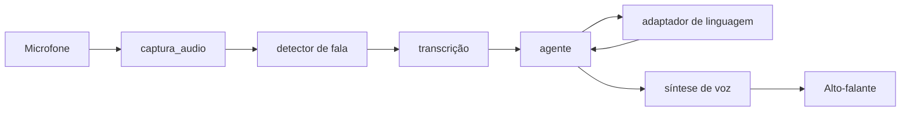

# Estrutura do Alfred

O código da aplicação fica em `src/alfred`. Cada pacote agrupa uma responsabilidade e as dependências externas entram pelos adaptadores.

```text
src/alfred/
├── adaptadores/
│   ├── llm/                 # Comunicação com provedores de linguagem, como Ollama
│   └── voz/                 # Captura, VAD, STT, TTS, números e pronúncias
├── configuracao/            # Configuração tipada e leitura de variáveis locais
├── ferramentas/
│   └── nativas/             # Ações do Alfred e validações de caminhos/dados
├── interfaces/
│   ├── cli/                 # Loop do terminal e sessão de conversa
│   ├── configuracao_voz/    # Interface local de configuração de voz
│   ├── ciclo_de_voz/        # Montagem e orquestração da sessão de voz
│   └── web/                 # Painel HTTP local
├── memoria/
│   ├── armazenamento/       # SQLCipher, Chroma, RAG, migrações e importações
│   └── perfil/              # Carregamento de perfil, pessoas e prompts
├── nucleo/
│   ├── agente/              # Conversa, roteamento e utilitários de streaming
│   └── politicas/           # Confirmação, atualidade, capacidades e alegações
└── seguranca/
    ├── auditoria/           # Registro auditável
    └── chaves/              # Provedores e derivação de chaves
```

## Outros diretórios

- `ui/`: interface do painel no navegador.
- `prompts/`: instruções de sistema do Alfred.
- `scripts/`: avaliação, preparação de modelos e utilitários de desenvolvimento.
- `testes/`: testes unitários, de memória e cenários de comportamento.
- `docs/adr/`: decisões de arquitetura e seus motivos.
- `dados/`: arquivos locais de execução, modelos, bancos, áudios de avaliação e dados de treinamento; não faz parte do código-fonte.

## Direção das dependências

1. As interfaces montam os componentes e recebem as entradas do usuário.
2. O núcleo coordena a conversa e aplica as políticas.
3. Os adaptadores conectam o núcleo a serviços externos e dispositivos.
4. Memória e ferramentas expõem operações ao núcleo por interfaces Python.
5. `configuracao` fornece valores tipados; não depende de interfaces ou adaptadores.

O código de domínio deve evitar ler variáveis de ambiente, iniciar serviços ou abrir caminhos globais diretamente. Essas tarefas pertencem às interfaces e aos adaptadores, onde podem ser configuradas e substituídas.

Para facilitar a navegação, `interfaces/cli/app.py` contém a interação com o terminal, enquanto `interfaces/cli/sessao.py` mantém o estado e as operações da conversa. No adaptador de voz, `texto_voz.py` organiza a fala, `numeros.py` converte valores e `pronuncias.py` trata o dicionário de pronúncias. O núcleo guarda `DivisorDeFrases` e a ponte de iteradores em `nucleo/agente/streaming.py`.

## Caminho de uma sessão de voz



O ciclo de voz é montado em `interfaces/ciclo_de_voz/app.py`; o fluxo ao vivo fica em `interfaces/ciclo_de_voz/orquestrador.py`. A lógica de conversa não deve depender da interface web ou da captura de áudio.
