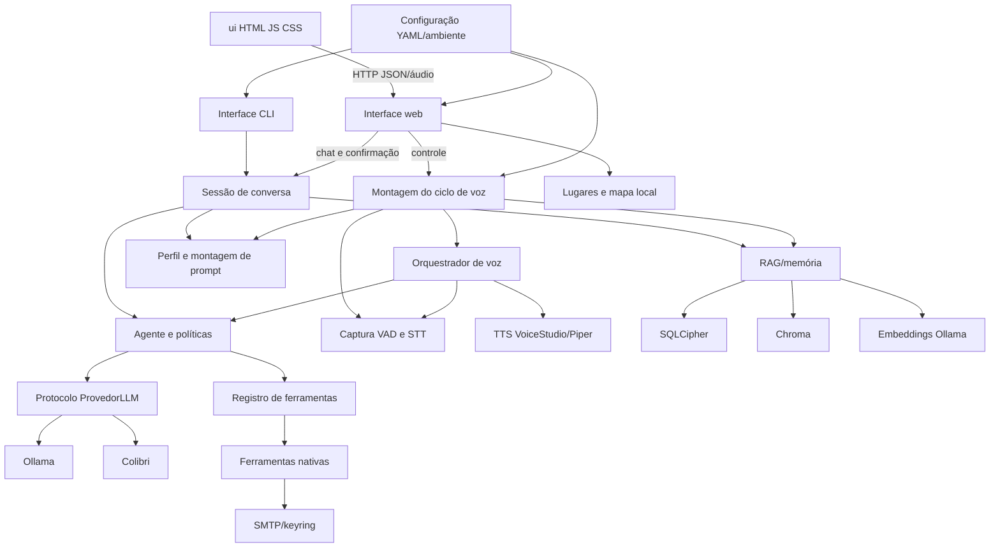

# Fase 1 — Mapa do projeto Alfred

**Escopo:** inspeção estática inicial em 2026-10-29 do repositório `alfred-fix/alfred-fix`. A branch `revisao-completa-alfred` foi criada antes de qualquer edição. O checkout irmão `../colibri` ainda não foi considerado parte do produto.

## Stack e comandos encontrados

- Python `>=3.11`, pacote `src/alfred`, build/setuptools. Dependências-base: SQLCipher, PyYAML, zstandard e keyring. Extras: pytest/Ruff (`dev`), Chroma (`memoria`) e áudio/STT/TTS (`voz`).
- Frontend HTML/CSS/JavaScript sem framework ou build declarado; MapLibre GL JS está vendorizado.
- Entradas: `alfred` (CLI), `alfred-armazenamento` (administração de bancos) e `alfred-painel` (servidor web), além de módulos para ciclo de voz e configurador de voz. Existem inicializadores Windows `.bat`.
- Pytest exclui por padrão marcadores `lento`, `integracao` e `ao_vivo`. Ruff aplica E4/E7/E9/F e formatação em 100 colunas. Não há type-checker configurado no `pyproject.toml`.

## Árvore funcional

```text
.
├── src/alfred/
│   ├── adaptadores/{llm,voz,fontes,notificacoes}/ provedores, voz e integrações
│   ├── configuracao/                              configuração e pronúncias
│   ├── ferramentas/{nativas}/                    registro, resultados e ações
│   ├── interfaces/{cli,ciclo_de_voz,configuracao_voz,web}/ entradas e UI backend
│   ├── memoria/{perfil,armazenamento,esquecimento,resumidores}/ perfil e memória
│   ├── nucleo/{agente,politicas,eventos,modelos,proatividade}/ lógica central
│   ├── seguranca/{auditoria,chaves,autenticacao,criptografia,integridade,isolamento}/ segurança
│   └── blueprint/                                 blueprint, riscos e templates
├── ui/                    cliente web, estilos, mapa e runtime MapLibre
├── prompts/               prompt de sistema
├── dados/                 bancos, perfil, modelos e arquivos locais
├── scripts/               avaliações, medições e preparação de recursos
├── testes/                testes unitários, memória, cenários e integrações
├── docs/                  arquitetura, integrações, ADRs, mapa offline e testes
└── config.yaml, .env.exemplo, pyproject.toml, requirements.txt, docker-compose.yml
```

O pacote tem 90 arquivos Python. A estrutura geral está descrita em `docs/ESTRUTURA_DO_PROJETO.md`. A presença de módulos/pastas não prova que estejam conectados ao fluxo principal; `fontes`, `notificacoes`, `eventos`, `modelos`, `proatividade`, `esquecimento`, `resumidores`, `autenticacao`, `criptografia`, `integridade` e `isolamento` serão confirmados na Fase 2.

## Entradas, serviços e tarefas de fundo

- **CLI:** `interfaces/cli/app.py` cria configuração, provedor e sessão; `sessao.py` mantém contexto/interação.
- **Voz:** `interfaces/ciclo_de_voz/app.py` monta agente, memória e adaptadores; `orquestrador.py` coordena captura, VAD, STT, turnos, streaming e TTS. Há asyncio, threads e filas, pendentes de revisão de cancelamento/ciclo de vida.
- **Painel:** `interfaces/web/app.py` usa `ThreadingHTTPServer` em `127.0.0.1:8765`. Rotas vistas incluem `/api/chat`, `/api/confirm`, `/api/status`, `/api/memory/graph`, `/api/voice/{state,catalog,start,stop,mute,settings,preview}` e `/api/mapa/{config,estilo,tiles/... ,lugares}`. `ui/app.js` e `ui/mapa/mapa.js` consomem via `fetch`.
- **Configurador de voz:** interface desktop em `interfaces/configuracao_voz/app.py`.
- **Integrações:** Ollama `localhost:11434`; VoiceStudio `127.0.0.1:3900/v1`; SMTP configurável. STT local Parakeet/sherpa-onnx ou faster-whisper; TTS VoiceStudio com Piper fallback. SQLCipher relacional e Chroma local.
- **Concorrência:** threads HTTP, subprocesso de voz iniciado pelo painel, callback de áudio, filas do ciclo, eventos de streaming e fila de reprodução. Nenhum scheduler/job de aplicação localizado.
- Não localizei nesta busca inicial PiP, ponte de pedidos de permissão IDE ou protocolo remoto. Pastas `seguranca/autenticacao` e `interfaces/api` requerem validação antes de concluir ausência funcional.

## Mapa de dependências



Visão de dependências principais observada em imports e montagem; a Fase 2 detalhará chamadas arquivo-a-arquivo e contratos.

## Fluxo de dados

1. Texto chega pela CLI ou POST `/api/chat`; áudio entra pelo callback de captura.
2. Na voz, frames passam por fila limitada, VAD identifica fala, STT local transcreve/normaliza e ambos os canais encaminham texto ao agente.
3. Sessão monta prompt com `prompts/system.txt`, configuração, perfil/pessoas e histórico temporário; RAG recupera contexto e usa embeddings locais.
4. Agente aplica roteamento/políticas e chama provedor LLM (Ollama local ou Colibri configurado).
5. Registro despacha ferramentas; resultado e confirmação retornam ao agente.
6. Resposta volta à CLI ou API web; em voz, frases transmitidas alimentam TTS e saída de áudio.
7. Turnos podem ser guardados no SQLCipher e indexados no Chroma quando chave e dependências estão disponíveis. Mapa serve PMTiles local e persiste lugares segundo a documentação.
8. E-mail usa SMTP após confirmação. Tiles HTTPS externos só se configurados; não há prova nesta fase de chamadas remotas para controle do Alfred.

## Configuração e protocolos identificados

- Configuração: `config.yaml`, `src/alfred/configuracao/configuracao.py`, `.env.exemplo` e variáveis `ALFRED_*`. Grupos no exemplo: Ollama/modelos, parâmetros de embeddings, diretórios/limites de arquivos e pessoas, janela/timeout, modo e ativação de voz, VAD, STT, Piper, VoiceStudio e fallback. `ALFRED_SQLCIPHER_CHAVE` é aceita mas não exemplificada. `docs/mapa-offline.md` lista opções `ALFRED_MAPA_*`. O consumo/precedência de cada valor será rastreado na Fase 2.
- HTTP local: painel `127.0.0.1:8765`; Ollama `localhost:11434` para modelos/chat/embeddings; VoiceStudio `127.0.0.1:3900/v1`. SMTP host/porta configuráveis, TLS/SSL e keyring.
- Concorrência/protocolos: asyncio, `asyncio.Queue`, `threading.Thread`/`Event`, `ThreadingHTTPServer`, eventos de streaming e callback de áudio. Não encontrei websocket, broker (Redis/RabbitMQ), nem porta de escuta além de loopback.

## Plano de ataque

1. **Fase 2:** rastrear chamadas reais e revisar contrato, erros, timeout/retry/cancelamento, recursos e concorrência. Prioridades: agente↔LLM↔ferramentas/confirmação; sessão/RAG/SQLCipher/Chroma; UI↔HTTP; voz↔LLM/TTS; configuração e integrações. Associar cada ligação ao teste existente ou lacuna; verificar ausência de PiP/IDE/remoto.
2. **Fase 3:** estabelecer linha de base de pytest, Ruff e auditor de dependências; type-checker se houver; procurar segredos sem revelar valores. Reproduzir achados e escrever caracterização antes de corrigir.
3. **Fase 4:** medir latência/CPU/memória antes; otimizar apenas gargalo reproduzível e medir em condição equivalente.
4. **Fase 5:** completar testes de contrato/falha das ligações ativas e rodar validações após cada correção, anotando limitações de hardware/serviços.
5. **Fase 6:** atualizar README e arquitetura; relatório com evidências arquivo:linha, métricas, breaking changes e pendências.
6. Mudanças pequenas e commits atômicos. **Bloqueio de Git:** consta `No commits yet on master` e todos os arquivos de produto estão `untracked`. A branch nova existe, mas não há histórico/base commit para commits atômicos. Não vou indexar/adicionar em lote sem inspecionar cuidadosamente o estado.

## Limites desta fase

- Inspeção estática inicial; contratos e chamadas precisam de validação dinâmica.
- Ainda não executei testes, lint, type-check, auditor de dependências, serviços, modelo ou hardware.
- O checkout irmão `../colibri` e sua relação com `adaptadores/llm/colibri.py` ainda serão confirmados.
- Diretórios temporários de pytest sem rastreamento foram preservados.
